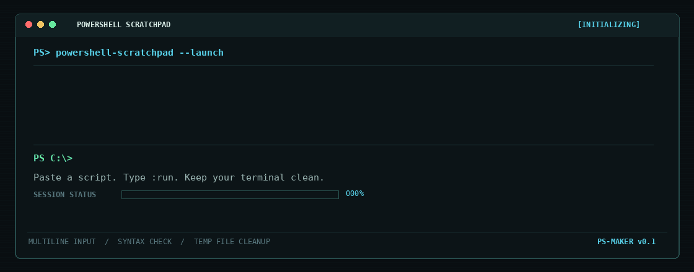

<p align="center">
  
</p>

<h1 align="center">PowerShell Scratchpad</h1>

<p align="center">
  A lightweight PowerShell utility for running multiline scripts
  directly from your terminal.
</p>

---


## Features

- Enter or paste multiline PowerShell scripts in the terminal.
- Use `:run` to execute the entered script.
- Use `:cancel` to cancel without executing the script.
- Interrupt input or execution with Ctrl+C.
- Validate PowerShell syntax before execution.
- Report PowerShell errors and nonzero process exit codes.
- Create uniquely named temporary script files.
- Attempt temporary-file cleanup after execution or cancellation.

## Requirements

- Windows
- Windows PowerShell 5.1 (tested)
- No external dependencies

PowerShell 7 compatibility has not yet been independently verified.

## Installation

1. Download or clone this repository.
2. Place the project in a stable directory.
3. Open Windows Terminal with a PowerShell tab.

For example, if the project is stored in `$HOME\Tools\ps-maker`,
load the command into the current session:

```powershell
$ScriptPath = Join-Path $HOME 'Tools\ps-maker\ps-maker.ps1'

if (-not (Test-Path -LiteralPath $ScriptPath)) {
    throw "ps-maker.ps1 not found: $ScriptPath"
}

. $ScriptPath
```

If Windows blocks a downloaded script, inspect the file and its source
before deciding whether to unblock it. Do not weaken your system-wide
execution policy merely to run an unfamiliar script.

### Load automatically in new sessions

After installing the project in the location above, open your PowerShell
profile:

```powershell
notepad $PROFILE
```

Add the following line, adjusting the path if you chose another location:

```powershell
. "$HOME\Tools\ps-maker\ps-maker.ps1"
```

Save the profile and open a new PowerShell session.

## Usage

Start the command:

```powershell
ps-maker
```

Enter or paste your script. Type `:run` on its own line to execute it.

Example input:

```powershell
$name = 'Ada'
Write-Output "Hello, $name"
:run
```

To cancel without executing the entered script, type `:cancel` on its own
line. Ctrl+C can be used to interrupt input or execution.

## Execution behavior

The submitted script runs in a child PowerShell process. This keeps an
`exit` statement in the submitted script from normally closing the parent
PowerShell session.

The child process does not inherit variables, aliases, or functions that
exist only in the parent session. It inherits the process environment and
working directory.

## Temporary files

The utility creates a uniquely named temporary `.ps1` file under the
operating system's temporary directory.

After execution or cancellation, it attempts to remove the temporary file.
If deletion fails, the utility should report the failure.

Deletion is not secure erasure. Cleanup cannot be guaranteed if the process
is forcibly terminated, Windows shuts down unexpectedly, or the file cannot
be removed.

## Security

ps-maker executes the script you provide. The script runs with the
permissions available to the current user; ps-maker is not a sandbox and
does not make untrusted scripts safe.

Only execute scripts you understand and trust.

## Tests

Run the source smoke test:

```powershell
.\tests\Test-Source.ps1
```

Run the automated test suite:

```powershell
.\tests\Test-All.ps1
```

Follow `tests\manual-test-plan.md` for manual checks, including Ctrl+C
behavior. Tests should be run in a suitable test environment before a
release.

## Project status

Early development. The automated test suite has passed in Windows
PowerShell 5.1. Manual Ctrl+C checks have also passed in the developer's
environment. This is not a guarantee of compatibility with every
PowerShell host or Windows configuration.

## License

Released under the MIT License. See `LICENSE`.
